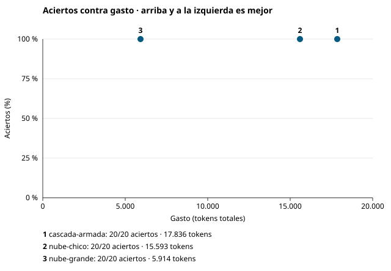

# Lab 1 · Decisión

## 1. Tabla de resultados

| Configuración | Aciertos | Inválidas | Tokens | Segundos | Costo estimado (USD) |
|---|---|---|---|---|---|
| cascada-armada | 20/20 | 0 | 17836 | 141.3 | 0.0 |
| nube-chico | 20/20 | 0 | 15593 | 107.4 | 0.0 |
| nube-grande | 20/20 | 0 | 5914 | 70.1 | 0.0 |

Modelos: nube-chico = liquid/lfm-3-1.7b:free (1,7B parámetros); nube-grande = nvidia/nemotron-3-ultra-550b-a55b:free (550B).

## 2. Gráfico

Las tres configuraciones tienen el mismo acierto (20 de 20), así que se diferencian solo por el gasto. El costo en dólares es 0 porque los modelos son gratuitos, por lo que uso tokens y segundos como medida de gasto. La cascada es la más cara de las tres: 17.836 tokens y 141 segundos, contra 15.593 y 107 del modelo chico y 5.914 y 70 del grande. Es decir, en esta prueba la cascada no mejoró la calidad y sí aumentó el gasto, porque cada reclamo dudoso se procesó dos veces.

Según la regla del gráfico (arriba y a la izquierda es mejor), nube-grande es la mejor de las tres en esta prueba: está al 100 % y es la que menos tokens gasta (5.914).

## 3. Casos importantes

- **Reclamo R07** ("El comercio aceptó la devolución pero en mi cuenta no se ve el crédito desde hace tres semanas"): el texto es claro y la categoría esperada es reembolso_pendiente. El modelo chico acertó, pero marcó confianza "baja" y escribió 1.596 tokens de salida, contra unos 350 en los casos seguros. La cascada lo envió al modelo grande, que también acertó. La escalada fue innecesaria: se pagó una segunda llamada por una respuesta que ya era correcta.
- **Reclamo R20** ("Veo dos cargos iguales del supermercado, aunque ese día hice dos compras parecidas. No estoy segura de si uno está repetido"): este texto es realmente ambiguo, porque la propia clienta duda. El modelo chico respondió cobro_duplicado (correcto) con confianza "baja", y la cascada lo escaló al grande, que coincidió. Aquí la duda del modelo fue razonable, aunque el resultado final no cambió.

En total, el modelo chico marcó confianza "baja" en 6 de 20 reclamos (R04, R07, R16, R17, R19, R20) y acertó los 6.

## 4. Regla de ruteo de modelos

| Tarea | Modelo o configuración | Por qué se elige | Riesgo y privacidad | Cuándo escalar |
|---|---|---|---|---|
| Clasificar reclamos claros | nube-grande directo | Con 20 reclamos fue el que usó menos tokens (5.914) y menos tiempo (70 s), con 20/20 de aciertos | Los modelos gratuitos pueden registrar los textos: no enviar nombres, números de tarjeta ni datos reales de clientes | Si devuelve una respuesta inválida |
| Reclamos de volumen alto y sencillo | nube-chico solo si hay un precio claramente menor | Es más barato por token si se paga, pero en esta prueba gastó más tokens que el grande | Mismo riesgo de privacidad | Cuando la confianza sea "baja" o la respuesta sea inválida |
| Reclamos ambiguos (como R17 o R20) | nube-grande, con revisión humana | La cliente misma duda, y el error tiene costo para la persona | Revisar a mano antes de actuar | Siempre pasan a una persona |
| Sospecha de fraude | Modelo + revisión humana obligatoria | Equivocarse tiene un costo alto para la cliente y para la empresa | Datos sensibles: usar solo datos anonimizados | Siempre |

Esta regla es provisional: se basa en 20 reclamos y en modelos gratuitos. Si se pagan, hay que recalcular el costo real por tarea antes de decidir.

## 5. Lo que el chequeo no verifica

No encontré ningún caso de confianza "alta" con respuesta equivocada: los 14 reclamos con confianza alta fueron correctos. Eso no prueba que no existan; con solo 20 reclamos puede ser casualidad.

El chequeo de la cascada usa la confianza que el propio modelo declara, así que no verifica que la respuesta sea correcta. Además, escaló 6 casos que ya estaban bien. Un chequeo mejor combinaría: (1) comparar contra un segundo modelo solo en una muestra, (2) reglas simples por palabras clave (por ejemplo, "no reconozco" apunta a fraude), (3) revisión humana de todos los casos de sospecha de fraude, y (4) probar periódicamente con un conjunto de reclamos ya etiquetados para detectar errores con confianza alta.